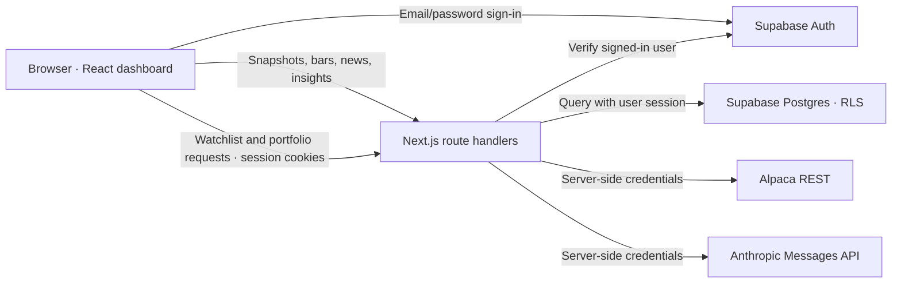

# Market Terminal

Market Terminal is a web dashboard for following equities and selected USD crypto pairs. It combines historical market data and quote snapshots to put a personal watchlist and portfolio in context. The application batches quote requests and keeps each user's saved data separate with database policies.

[Live demo](https://market-terminal-dashboard.vercel.app/) · [Dashboard screenshot](public/screenshot.png)


## Features

- **Market dashboard.** Scrolling equity ticker, market and sector overview, and an interactive sector heatmap. The heatmap uses a curated stock universe and size weights, with colors based on daily percentage change.
- **Instrument details.** Stock and crypto charts with 1D, 1W, and 1M ranges. Equity details include price and volume statistics, ticker-specific news, and optional Claude analysis.
- **Symbol search.** Find instruments by symbol or name within the bundled universe of stocks, ETFs, and crypto pairs.
- **Watchlist and portfolio.** Sign in with email and password to add or remove watchlist symbols and record, edit, or remove positions. The portfolio computes unrealized profit and loss from tracked prices and user-entered cost basis.
- **Market data.** Alpaca REST provides equity and crypto snapshots and historical bars. Equity widgets show a snapshot fetched when the view or instrument loads.

## Tech stack

| Technology | Responsibility |
| --- | --- |
| Next.js 15, React 19, TypeScript | App Router pages, route handlers, typed data models, and client state |
| Tailwind CSS and Lightweight Charts | Dashboard layout and historical price charts |
| Alpaca Market Data | REST snapshots, historical bars, and news |
| Supabase Auth and PostgreSQL | Email/password sessions and per-user watchlist and portfolio storage |
| Anthropic Claude | Optional structured stock analysis |
| Vercel and GitHub Actions | Hosting and a workflow that type-checks pull requests and builds and deploys pushes to main |

## Architecture



Pages and route handlers live in [`app/`](app/). [`lib/alpaca.ts`](lib/alpaca.ts) fetches REST data and normalizes snapshots for the UI. [`middleware.ts`](middleware.ts) refreshes Supabase sessions, and the private route handlers verify the user before querying tables protected by [row-level security](supabase-schema.sql).

## Getting started

Use Node.js 20.19 or later in the 20.x line with npm to match the repository's CI configuration. A Supabase project and Alpaca Market Data credentials are required for the full REST and account flows.

```bash
git clone https://github.com/alexmekhail/Market-Terminal.git
cd Market-Terminal
npm ci
cp .env.local.example .env.local
```

Configure `.env.local` using the checked-in [template](.env.local.example).

| Variable | Scope and purpose |
| --- | --- |
| `ALPACA_API_KEY`, `ALPACA_API_SECRET` | Server only. Required for Alpaca REST requests. |
| `NEXT_PUBLIC_SUPABASE_URL`, `NEXT_PUBLIC_SUPABASE_ANON_KEY` | Public Supabase project URL and anon key. Required for authentication and saved data. |
| `ANTHROPIC_API_KEY` | Optional and server only. Enables Claude analysis. The insights route returns fallback content if omitted. |

1. Enable the email/password provider in Supabase. Run [`supabase-schema.sql`](supabase-schema.sql) once in the SQL Editor of your development project to create the tables and policies. If email confirmation is enabled, configure the Supabase Site URL and confirm the account before signing in.
2. Run `npm run dev` and open [localhost:3000](http://localhost:3000).
3. To preview a production build, run `npm run build` followed by `npm start`. The current build fetches Inter and JetBrains Mono from Google Fonts. Set any needed `NEXT_PUBLIC_*` values before building because Next.js embeds them in the browser bundle.

## Security

Preview deployments can build without Supabase credentials. Configure the public Supabase settings for the preview environment to enable account features.

- REST credentials and the Anthropic key belong in server-only environment variables. Store local values in the ignored `.env.local` file and configure hosted values through your deployment environment.
- The watchlist and portfolio APIs verify the current user with Supabase Auth. Row-level security restricts access to rows owned by that user. The application uses the Supabase anon key with the user's session.
- The retired browser stream sent an Alpaca key and secret from browser JavaScript. Treat any pair shipped that way as exposed. Rotate it through Alpaca and remove the legacy `NEXT_PUBLIC_ALPACA_API_KEY` and `NEXT_PUBLIC_ALPACA_API_SECRET` settings. This release reads Alpaca credentials only on the server.
- Watchlist and portfolio queries filter by the verified user's ID, and writes derive row ownership from that identity. The protected routes return `401` when session verification fails and `503` when Supabase is unconfigured. The SQL policies also enforce ownership at the database.
- AI Insights allows up to 60 provider attempts per minute and eight in flight per application instance. Matching cached results can still be served when the provider quota is exhausted. Instances and cold starts have independent budgets, so these limits provide no account-wide spending guarantee. A coordinated limit would require a shared store such as Redis, provider spend limits, and a policy for caller quotas and server-sourced metrics.

## Streaming and deployment limits

The application uses REST snapshots. It has no browser connection to Alpaca, and quote widgets refresh when loaded. A future streaming option would use a long-lived relay with one upstream connection per feed and keep provider credentials on that service. The relay could fan out normalized quotes over authenticated SSE or WebSockets, enforce subscription limits, and perform upstream reconnects with jitter, resubscription, and offline handling. That design needs hosting and authorization decisions before implementation.

## Engineering challenges

- **Snapshot lifecycle.** Batched REST requests supply quote widgets. Effects cancel outdated requests on navigation or account changes.
- **Market data presentation.** The treemap groups curated symbols by sector and separates tile sizing from return-based coloring. The chart layer transforms historical data into time-ordered price series, and the equity 1D view selects the most recent day represented in the returned bars.
- **Provider cost and latency.** News requests use a five-minute revalidation window. The AI panel starts when price data becomes available and supports manual refresh. The route applies a response timeout and falls back when the provider fails or returns an invalid result.

## Testing

```bash
npm test
npm run lint
npx tsc --noEmit
npm run build
npm audit
```

The Node tests exercise route handlers with mocked Supabase and Anthropic responses. They cover session rejection, user scoping, malformed input, AI cooldown and cache expiry, concurrent duplicate requests, and provider fallback.

To run the database policy fixture, use a fresh disposable PostgreSQL database with a role that can create schemas and roles. The script applies the repository schema, exercises row-level security with two synthetic identities, and rolls back.

```bash
psql -X --dbname market_terminal_disposable --file tests/rls.sql
```

The fixture models Supabase's authenticated role and `auth.uid()`. For hosted verification, use two accounts in a separate Supabase test project to confirm token expiration, auth callbacks, and cross-account access. To smoke-test market data manually, open an equity and a crypto chart with development Alpaca credentials.
