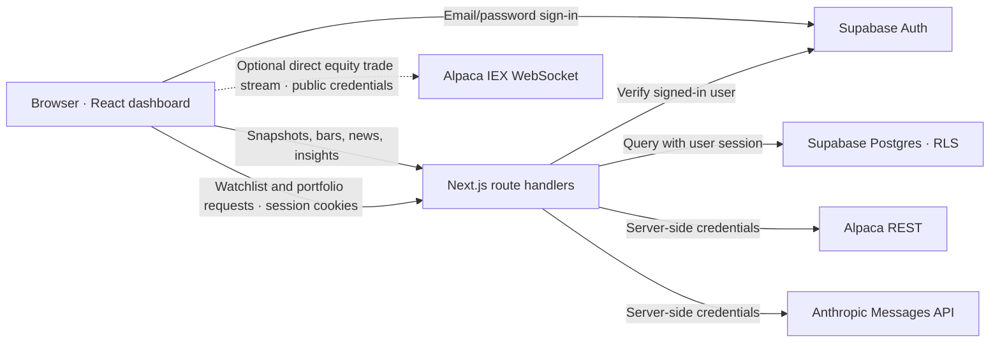

# Market Terminal

Market Terminal is a web dashboard for following equities and selected USD crypto pairs. It combines historical and current market data with live equity trades, then uses those prices to put a personal watchlist and portfolio in context. The application batches quote requests, shares a streaming connection across components, and keeps each user's saved data separate with database policies.

[Live demo](https://market-terminal-dashboard.vercel.app/) · [Dashboard screenshot](public/screenshot.png)


## Features

- **Market dashboard.** Scrolling equity ticker, market and sector overview, and an interactive sector heatmap. The heatmap uses a curated stock universe and size weights, with colors based on daily percentage change.
- **Instrument details.** Stock and crypto charts with 1D, 1W, and 1M ranges. Equity details include price and volume statistics, ticker-specific news, and optional Claude analysis.
- **Symbol search.** Find instruments by symbol or name within the bundled universe of stocks, ETFs, and crypto pairs.
- **Watchlist and portfolio.** Sign in with email and password to add or remove watchlist symbols and record, edit, or remove positions. The portfolio computes unrealized profit and loss from tracked prices and user-entered cost basis.
- **Two quote paths.** Alpaca REST snapshots provide initial prices and historical bars. With optional streaming configured, IEX equity trades update subscribed widgets. Crypto prices and charts use REST.

## Tech stack

| Technology | Responsibility |
| --- | --- |
| Next.js 15, React 19, TypeScript | App Router pages, route handlers, typed data models, and client state |
| Tailwind CSS and Lightweight Charts | Dashboard layout and historical price charts |
| Alpaca Market Data | REST snapshots, historical bars, news, and IEX equity trade streaming |
| Supabase Auth and PostgreSQL | Email/password sessions and per-user watchlist and portfolio storage |
| Anthropic Claude | Optional structured stock analysis |
| Vercel and GitHub Actions | Hosting and a workflow that type-checks pull requests and builds and deploys pushes to main |

## Architecture



Pages and route handlers live in [`app/`](app/). [`lib/alpaca.ts`](lib/alpaca.ts) fetches REST data and normalizes snapshots for the UI. [`lib/alpacaSocket.ts`](lib/alpacaSocket.ts) tracks per-symbol subscriptions and reconnects after disconnections. [`middleware.ts`](middleware.ts) refreshes Supabase sessions, and the private route handlers verify the user before querying tables protected by [row-level security](supabase-schema.sql).

## Getting started

Use Node.js 20.19 or later in the 20.x line with npm to match the repository's CI configuration. A Supabase project and Alpaca Market Data credentials are required for the full REST and account flows.

```bash
git clone https://github.com/alexmekhail/Market-Terminal.git
cd Market-Terminal
npm ci
cp .env.local.example .env.local
```

Configure `.env.local` using the checked-in [template](.env.local.example).

| Variable | Scope and purpose |
| --- | --- |
| `ALPACA_API_KEY`, `ALPACA_API_SECRET` | Server only. Required for Alpaca REST requests. |
| `NEXT_PUBLIC_SUPABASE_URL`, `NEXT_PUBLIC_SUPABASE_ANON_KEY` | Public Supabase project URL and anon key. Required for authentication and saved data. |
| `ANTHROPIC_API_KEY` | Optional and server only. Enables Claude analysis. The insights route returns fallback content if omitted. |
| `NEXT_PUBLIC_ALPACA_API_KEY`, `NEXT_PUBLIC_ALPACA_API_SECRET` | Optional legacy streaming configuration. Leave both blank for snapshot-only quotes. Any credential pair set here is public. |

1. Enable the email/password provider in Supabase. Run [`supabase-schema.sql`](supabase-schema.sql) once in the SQL Editor of your development project to create the tables and policies. If email confirmation is enabled, configure the Supabase Site URL and confirm the account before signing in.
2. Run `npm run dev` and open [localhost:3000](http://localhost:3000).
3. To preview a production build, run `npm run build` followed by `npm start`. The current build fetches Inter and JetBrains Mono from Google Fonts. Set any needed `NEXT_PUBLIC_*` values before building because Next.js embeds them in the browser bundle.

## Security

Preview deployments can build without Supabase credentials. Configure the public Supabase settings for the preview environment to enable account features.

- REST credentials and the Anthropic key belong in server-only environment variables. Store local values in the ignored `.env.local` file and configure hosted values through your deployment environment.
- The watchlist and portfolio APIs verify the current user with Supabase Auth. Row-level security restricts access to rows owned by that user. The application uses the Supabase anon key with the user's session.
- **Direct Alpaca streaming exposes the configured key and secret to every browser.** Use the REST-only configuration for public deployments until streaming credentials can be held server-side. Treat any credential previously shipped in a public build as exposed and rotate it through Alpaca. Changes to public environment variables require a new build.
- Public market-data and AI routes use provider quotas. The AI route validates inputs and model output, bounds its per-process cache and concurrency, and limits successful refreshes for each ticker to one per minute. Cached results are returned only for matching inputs. A public deployment still needs shared rate limits and a provider budget.

## Engineering challenges

- **Snapshot and stream coordination.** Batched REST requests seed current prices and previous closes. The shared socket fans out IEX trades to subscribed widgets and calculates price changes against the previous close. Reconnects use capped backoff and restore active subscriptions.
- **Market data presentation.** The treemap groups curated symbols by sector and separates tile sizing from return-based coloring. The chart layer transforms historical data into time-ordered price series, and the equity 1D view selects the most recent day represented in the returned bars.
- **Provider cost and latency.** News requests use a five-minute revalidation window. The AI panel starts when price data becomes available and supports manual refresh. Individual trade ticks no longer request new analysis. The route applies a response timeout and falls back when the provider fails or returns an invalid result.

## Testing

```bash
npm run lint
npx tsc --noEmit
npm run build
```

ESLint checks the Next.js and React code. TypeScript checks the source without emitting JavaScript. The production build checks compilation and route generation. This repository has no automated unit or integration suite.

For a manual smoke test, load the dashboard with streaming disabled, open an equity and a crypto chart, then sign in and add and remove a watchlist entry and a portfolio position. Use two development accounts to verify that each sees only its own saved rows. With a disposable development streaming configuration, verify that equity widgets resume updating after a network interruption.
